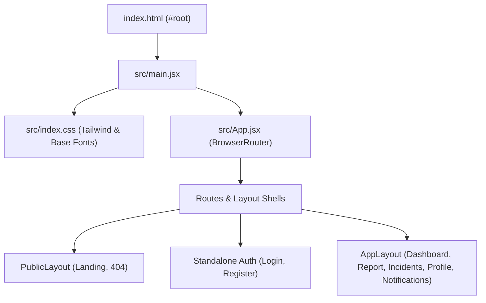
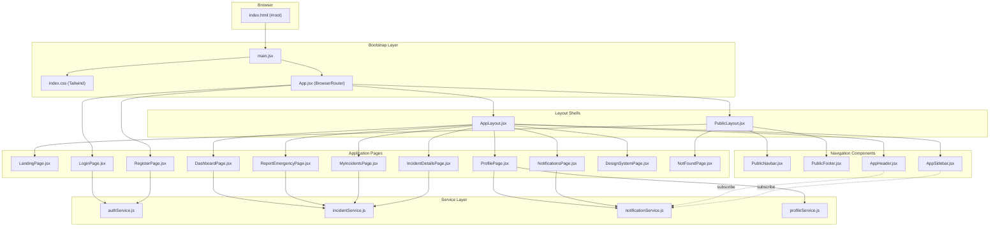
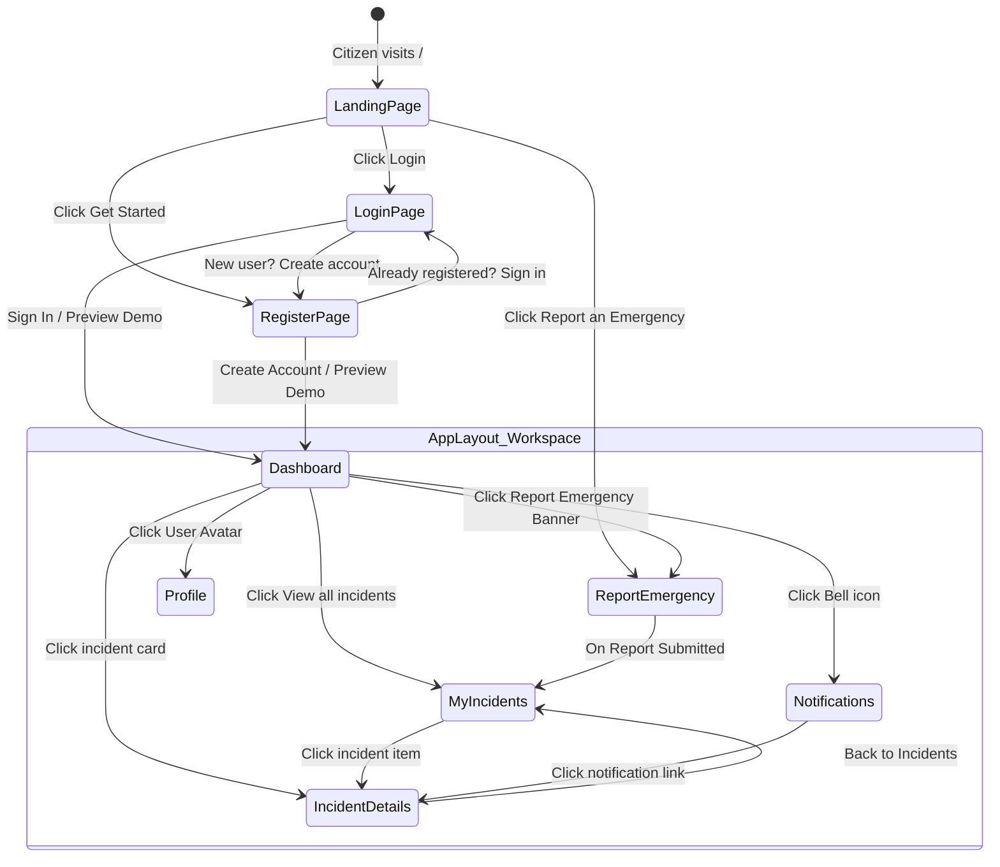
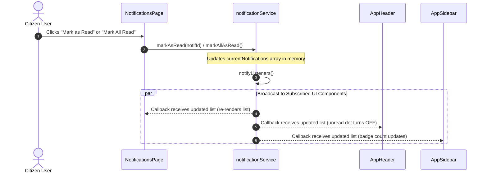

# ResQOne — Architecture & Codebase File Map

> **Repository:** [https://github.com/Amrit17612/ResQOne](https://github.com/Amrit17612/ResQOne)  
> **Architecture Pattern:** Modular Component Architecture with Service Layer Decoupling & Reactive Pub/Sub  
> **Styling Framework:** Tailwind CSS with Custom Design Tokens  
> **Primary Design Specification:** [`src/assets/mockup_reference.png`](../src/assets/mockup_reference.png)

---

## 1. Verified Directory & File Map

```
/Users/a6203427868/Desktop/ResQone/
├── .env.example                     # Environment template defining VITE_API_BASE_URL
├── .gitignore                       # Git exclusions for dependencies, builds, and local envs
├── index.html                       # HTML5 root template with viewport & Inter font
├── package.json                     # Project manifest and npm scripts (dev, build, preview)
├── package-lock.json                # Locked dependency tree
├── postcss.config.js                # PostCSS config (Tailwind + Autoprefixer)
├── README.md                        # Quick project overview
├── tailwind.config.js               # Design tokens, custom colors (red, navy, status), shadows
├── vite.config.js                   # Vite bundler config with React plugin & port 3000
│
├── dist/                            # Production build output (generated by `npm run build`)
│   ├── index.html
│   └── assets/
│
├── docs/                            # Technical documentation & AI handover records
│   ├── README.md                    # AI Handover master document & quickstart
│   ├── PROJECT_OVERVIEW.md          # Functional specifications & citizen user journey
│   ├── PHASE_1_MILESTONE_HISTORY.md # Chronological verification of Milestones 1 to 9
│   ├── ARCHITECTURE_AND_FILE_MAP.md # This document: codebase map & architecture
│   ├── DESIGN_SYSTEM.md             # Visual design tokens & component specifications
│   └── BACKEND_INTEGRATION_GUIDE.md # API contracts & integration guide for Backend Team
│
└── src/
    ├── main.jsx                     # Application bootstrap mounting <App /> into #root
    ├── App.jsx                      # Primary client-side router & route table (React Router v6)
    ├── index.css                    # Tailwind directives, font definitions, scrollbar styles
    │
    ├── assets/                      # Visual assets, reference mockups, photographic media
    │   ├── mockup_reference.png     # Approved master UI mockup (1795 KB)
    │   ├── hero_ambulance.jpg       # Landing page hero visual (874 KB)
    │   ├── auth_rescue.jpg          # Login/Register split-screen left panel visual (939 KB)
    │   ├── incident_car_accident.jpg# Dashboard & incident card visual (900 KB)
    │   └── safety_rain.jpg          # Dashboard weather advisory visual (1031 KB)
    │
    ├── components/
    │   ├── common/                  # Reusable atomic UI components
    │   │   ├── Alert.jsx            # Notification banner with 4 variants (info, success, warning, danger)
    │   │   ├── Badge.jsx            # Status pills (progress, resolved, reported, verified, danger, info)
    │   │   ├── Button.jsx           # Standard buttons (primary red, outline, secondary, ghost, danger)
    │   │   ├── Card.jsx             # Card container with Header, Title, Description, Content, Footer
    │   │   ├── EmptyState.jsx       # Standard empty data fallback with icon and CTA
    │   │   ├── Input.jsx            # Form input with label, prefix icon, and error validation text
    │   │   ├── LoadingSpinner.jsx   # Accessible loading spinner
    │   │   ├── Logo.jsx             # ResQOne brand logo (dark and light variants)
    │   │   └── Modal.jsx            # Accessible dialog modal with backdrop and Escape key listener
    │   │
    │   └── layout/                  # Shared layout navigation bars and headers
    │       ├── AppHeader.jsx        # Sticky workspace header with dynamic title, subtitle, unread bell, citizen profile
    │       ├── AppSidebar.jsx       # Persistent deep navy sidebar (#111827) with active red route indicator
    │       ├── PublicNavbar.jsx     # Responsive visitor navbar with anchor links and auth buttons
    │       └── PublicFooter.jsx     # Visitor footer with civic links, copyright, and emergency 112 hotline
    │
    ├── layouts/                     # High-level layout shells
    │   ├── AppLayout.jsx            # Authenticated workspace shell (Sidebar + Header + <Outlet />)
    │   └── PublicLayout.jsx         # Public visitor shell (Navbar + <Outlet /> + Footer)
    │
    ├── pages/                       # Application route page components
    │   ├── LandingPage.jsx          # Public citizen landing portal (/)
    │   ├── LoginPage.jsx            # Citizen split-screen login page (/login)
    │   ├── RegisterPage.jsx         # Citizen split-screen registration page (/register)
    │   ├── DashboardPage.jsx        # Citizen dashboard with stats, emergency banner, carousel (/dashboard)
    │   ├── ReportEmergencyPage.jsx  # 7-card incident reporting form with real GPS & file upload (/report, /report-emergency)
    │   ├── MyIncidentsPage.jsx      # Citizen incident list with status tabs & search query (/incidents)
    │   ├── IncidentDetailsPage.jsx  # 5-stage timeline, responder card, GPS location preview (/incidents/:id)
    │   ├── ProfilePage.jsx          # Citizen profile, emergency contact card, settings modals (/profile)
    │   ├── NotificationsPage.jsx    # Real-time alert feed with All/Unread filters & mark read (/notifications)
    │   ├── DesignSystemPage.jsx     # Interactive showcase of design tokens and components (/design-system)
    │   ├── NotFoundPage.jsx         # 404 error page (/404)
    │   ├── LandingPlaceholder.jsx   # Legacy M2 placeholder (retained for reference)
    │   └── AppPlaceholders.jsx      # Legacy M2/M7 placeholders (retained for reference)
    │
    └── services/                    # Data access layer, API clients, and in-memory state stores
        ├── authService.js           # Citizen auth stubs (login, register, requestPasswordReset)
        ├── incidentService.js       # Demo incidents dataset (DEMO_INCIDENTS), summary metrics, submitIncidentReport
        ├── notificationService.js   # Demo notification store, markAsRead, and reactive pub/sub event bus
        └── profileService.js        # Demo citizen profile store (Rohan Singh) and updateProfile handler
```

---

## 2. Application Entry Point & Bootstrap Pipeline

The application bootstrap sequence is standard and predictable:



1. **`index.html`**: Defines the single `<div id="root"></div>` container, loads the Google Fonts *Inter* stylesheet, and injects `<script type="module" src="/src/main.jsx"></script>`.
2. **`src/main.jsx`**: Initializes the React 18 concurrent root (`ReactDOM.createRoot()`), mounts `<App />`, and imports `src/index.css`.
3. **`src/index.css`**: Injects Tailwind directives (`@tailwind base`, `@tailwind components`, `@tailwind utilities`), configures the light color scheme, Inter font stack, custom subtle scrollbar styles, and component utility classes (`.resq-btn`).
4. **`src/App.jsx`**: Instantiates `<BrowserRouter>` and establishes the full route hierarchy.

---

## 3. Routing Architecture

The routing map in `src/App.jsx` is divided into three distinct operational domains:

```
                                  BrowserRouter (App.jsx)
                                            │
         ┌──────────────────────────────────┼──────────────────────────────────┐
         │                                  │                                  │
         ▼                                  ▼                                  ▼
   Public Visitor Shell            Standalone Auth Pages           Authenticated Workspace Shell
   (PublicLayout.jsx)              (Split-Screen Layout)           (AppLayout.jsx)
         │                                  │                                  │
  ├── / (LandingPage)                ├── /login (LoginPage)         ├── /dashboard (DashboardPage)
  └── /404 (NotFoundPage)            └── /register (RegisterPage)   ├── /report (ReportEmergencyPage)
                                                                    ├── /report-emergency (ReportEmergencyPage alias)
                                                                    ├── /incidents (MyIncidentsPage)
                                                                    ├── /incidents/:id (IncidentDetailsPage)
                                                                    ├── /profile (ProfilePage)
                                                                    ├── /notifications (NotificationsPage)
                                                                    └── /design-system (DesignSystemPage)
         │
         └─────────────────────────► Catch-all `*` redirects to `/404` (Replace history)
```

### Route Alias Support:
- `/report` and `/report-emergency` both mount `ReportEmergencyPage.jsx`.
- In `AppSidebar.jsx`, the active state comparison checks:  
  `const isItemActive = isActive || (item.path === '/report' && location.pathname === '/report-emergency');`  
  This ensures that visiting `/report-emergency` correctly keeps the "Report Emergency" sidebar item illuminated in emergency red.
- In `AppLayout.jsx`, `getHeaderMeta()` handles both paths identically to display:  
  `{ title: 'Report an Emergency', subtitle: 'Provide accurate information to get faster help.' }`.

---

## 4. Component Hierarchy & Responsibilities

### 4.1 Layout Shells
- **`src/layouts/PublicLayout.jsx`**:
  - Renders sticky top navigation (`PublicNavbar`), main content container (`<Outlet />`), and civic marketing footer (`PublicFooter`).
- **`src/layouts/AppLayout.jsx`**:
  - Encapsulates the citizen workspace.
  - Controls mobile sidebar drawer state (`sidebarOpen`).
  - Evaluates current route via `useLocation()` and computes matching page `title` and `subtitle`.
  - Mounts persistent desktop sidebar (`AppSidebar`) on `md:` screens and off-canvas drawer on mobile.
  - Mounts top sticky workspace header (`AppHeader`) with hamburger trigger.

### 4.2 Layout Navigation Components
- **`src/components/layout/AppSidebar.jsx`**:
  - Fixed-width `w-64` deep navy background (`#111827`).
  - Renders brand `Logo` at top with white text variant.
  - Nav items: Dashboard, Report Emergency, My Incidents, Notifications, Profile.
  - Active route highlighted in solid emergency red (`bg-red-600 text-white`).
  - Subscribes to `notificationService.subscribe()` to display live unread count badge.
  - Bottom section features a logout action linking to `/login`.
- **`src/components/layout/AppHeader.jsx`**:
  - Height `h-16`, clean white surface with subtle bottom border (`border-slate-200/80`).
  - Left: Mobile hamburger menu toggle button + dynamic page title and subtitle.
  - Right: Notification bell with unread dot indicator + citizen profile avatar (`RS` / Rohan Singh).
  - Subscribes to `notificationService.subscribe()` to control the unread dot indicator.
- **`src/components/layout/PublicNavbar.jsx`**:
  - White surface with brand logo and navigation links (`Home`, `About`, `How It Works`, `Contact`).
  - Quick action buttons: `Login` (outline button) and `Report an Emergency` (red button).
  - Mobile slide-down menu on smaller viewports.
- **`src/components/layout/PublicFooter.jsx`**:
  - Dark footer surface (`#0f172a`) with brand summary, quick links, emergency response hotlines (112, 101, 102, 100), and legal copyright notice.

### 4.3 Shared UI Component Library (`src/components/common/`)

| Component | Props / Variants | Primary Responsibilities |
| :--- | :--- | :--- |
| **`Button.jsx`** | `variant`: `primary`, `outline`, `secondary`, `ghost`, `danger`<br>`size`: `sm`, `md`, `lg`<br>`icon`, `iconPosition`, `loading`, `disabled` | Standardized button with loading spinner, disabled states, and hover effects. |
| **`Input.jsx`** | `label`, `error`, `helperText`, `icon` (prefix), `type`, `disabled`, standard HTML attributes | Text field with red validation state, accessible label, and icon adornment. |
| **`Card.jsx`** | Subcomponents: `CardHeader`, `CardTitle`, `CardDescription`, `CardContent`, `CardFooter` | Surface container with subtle border (`border-slate-200/80`) and standard padding. |
| **`Badge.jsx`** | `variant`: `progress`, `resolved`, `reported`, `verified`, `danger`, `info`<br>`size`: `sm`, `md` | Status indicator pills matching exact colors from `mockup_reference.png`. |
| **`Alert.jsx`** | `variant`: `info`, `success`, `warning`, `danger`<br>`title`, `onDismiss` | Prominent notification banner with matching Lucide icons. |
| **`Modal.jsx`** | `isOpen`, `onClose`, `title`, `children`, `footer` | Accessible dialog with dark backdrop blur, Escape key listener, and body scroll lock. |
| **`Logo.jsx`** | `variant`: `light`, `dark`<br>`size`: `sm`, `md`, `lg`<br>`to` (optional link) | Shield icon with dual-tone brand wordmark: `ResQ` (navy/white) + `One` (red). |
| **`LoadingSpinner.jsx`** | `size`: `sm`, `md`, `lg`<br>`className` | Circular animated SVG spinner for async operations. |
| **`EmptyState.jsx`** | `icon`, `title`, `description`, `action` | Fallback view for empty search queries or empty incident lists. |

---

## 5. Services Layer & Data Flow

All application data flows through dedicated services in `src/services/`. UI components never access hardcoded data directly; they interact through async service signatures:

```
[ UI Components (Pages) ]
           │
           │ (Calls async methods: getIncidents, markAsRead, updateProfile, submitReport)
           ▼
[ Service Layer (src/services/) ]
 ├── incidentService.js     ──► Manages DEMO_INCIDENTS, summary math, client report submission
 ├── notificationService.js ──► Manages notifications array, read states, and Pub/Sub Event Bus
 ├── profileService.js      ──► Manages Rohan Singh demo profile & temporary in-memory updates
 └── authService.js         ──► Prepared API client reading import.meta.env.VITE_API_BASE_URL
           │
           ▼
[ Future Backend REST API ] (Base URL: http://localhost:5000/api)
```

### 5.1 Reactive Pub/Sub State Management (`notificationService.js`)
To synchronize the unread notification count across `NotificationsPage`, `AppHeader`, and `AppSidebar` without introducing heavy dependencies like Redux or Zustand, `notificationService.js` implements a lightweight in-memory **Observer pattern**:

```javascript
// src/services/notificationService.js
let currentNotifications = INITIAL_NOTIFICATIONS.map((n) => ({ ...n }));
const listeners = new Set();

function notifyListeners() {
  listeners.forEach((callback) => {
    try {
      callback([...currentNotifications]);
    } catch (e) {
      console.error('Notification listener error:', e);
    }
  });
}

export const notificationService = {
  subscribe(callback) {
    listeners.add(callback);
    callback([...currentNotifications]); // Immediate initial invocation
    return () => listeners.delete(callback); // Unsubscribe cleanup
  },
  async markAsRead(id) {
    currentNotifications = currentNotifications.map((n) =>
      n.id === id ? { ...n, read: true } : n
    );
    notifyListeners();
  },
  async markAllAsRead() {
    currentNotifications = currentNotifications.map((n) => ({ ...n, read: true }));
    notifyListeners();
  }
};
```

Whenever any component marks a notification as read, all subscribed components instantly re-render with the latest counts!

---

## 6. Comprehensive Mermaid Diagrams

### 6.1 Application Component Architecture



---

### 6.2 Citizen Navigation & User Flow



---

### 6.3 Reactive State & Notification Synchronization Flow



---

## 7. Recipe: Pattern for Adding a New Page or Feature

To maintain strict codebase consistency when adding a new page in the future, follow this verified 5-step recipe:

### Step 1: Create the Page Component in `src/pages/`
```jsx
// src/pages/NewFeaturePage.jsx
import React, { useState, useEffect } from 'react';
import Card, { CardHeader, CardTitle, CardContent } from '../components/common/Card';
import Button from '../components/common/Button';

export default function NewFeaturePage() {
  return (
    <div className="space-y-6 antialiased text-slate-900">
      <Card>
        <CardHeader>
          <CardTitle>Feature Title</CardTitle>
        </CardHeader>
        <CardContent>
          <p className="text-sm text-slate-600">Feature description...</p>
        </CardContent>
      </Card>
    </div>
  );
}
```

### Step 2: Register the Route in `src/App.jsx`
Import your page and add the `<Route>` element under either `PublicLayout` or `AppLayout`:
```jsx
import NewFeaturePage from './pages/NewFeaturePage';

// Inside AppLayout:
<Route path="/new-feature" element={<NewFeaturePage />} />
```

### Step 3: Add Header Title in `src/layouts/AppLayout.jsx`
Update `getHeaderMeta()` so the top header renders the appropriate title and subtitle:
```javascript
case '/new-feature':
  return { title: 'New Feature', subtitle: 'Manage your feature details.' };
```

### Step 4: Add Navigation Item in `src/components/layout/AppSidebar.jsx` (if applicable)
Add an item to the `navItems` array with a Lucide icon:
```javascript
{ name: 'New Feature', path: '/new-feature', icon: Sparkles }
```

### Step 5: Verify Build
Run `npm run build` from the project root to ensure 0 bundle errors or missing imports.
