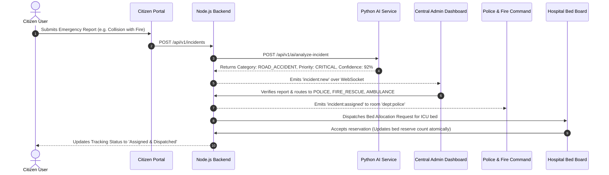

# ResQOne: Architecture, Systems Verification & Operational Guide

**AI-Powered Emergency Response, Disaster Management & Multi-Department Coordination Platform**  
*Capstone Final Year Project – Computer Science & Engineering*

---

## 1. System Ecosystem & Active Topology

```
[ Frontend: React 18 + Vite (Port 5173) ]
                   │
                   ▼  REST & WebSockets
[ Central Backend: Express + Socket.IO (Port 5001) ]
         │                               │
         ▼                               ▼
[ MongoDB 7.0 Replica ]         [ Python AI FastAPI (Port 8000) ]
(Geospatial 2dsphere Indexes)   (NLP Classifier & Multi-Attribute Ranker)
```

| Service | Technology | Port / Endpoint | Responsibility |
| :--- | :--- | :--- | :--- |
| **Frontend Application** | React 18, Vite, Tailwind CSS, Lucide | `http://localhost:5173` | Unified 10-dashboard portal with role switcher |
| **Central Backend** | Node.js, Express, ES Modules | `http://localhost:5001` | Core business logic, RBAC & transactional state |
| **Real-Time Gateway** | Socket.IO (v4.8) | `ws://localhost:5001` | Dispatch rooms, telemetry updates |
| **AI Advisory Microservice**| Python 3.9, FastAPI, Pydantic | `http://localhost:8000` | Incident classification & suitability scoring |
| **Database** | MongoDB 7.0 Community | `127.0.0.1:27017/resqone` | GeoJSON persistence & optimistic locking |

---

## 2. End-to-End Operational Lifecycle Walkthrough



---

## 3. The 10 Specialized Dashboards

1. **Citizen Emergency Portal (`/citizen`):**
   - Incident reporting wizard with automatic browser GPS tagging.
   - Live Reference ID status tracker.
   - Real-time Hospital Bed Locator showing ICU, oxygen, and trauma capacity.
   - Offline draft queue that stores reports locally and syncs them once connectivity is restored.

2. **Central Emergency Admin Dashboard (`/admin`):**
   - Incident intake and triage board with live KPIs.
   - Side-by-side AI Advisory Decision panel with confidence scores.
   - Multi-department assignment selector (Police, Fire, EMS, Disaster).
   - Instant verification and rejection workflow.

3. **Police Command Dashboard (`/police`):**
   - Case tracking filtered specifically to police-assigned incidents.
   - PCR van dispatch, perimeter security, and scene investigation status progression.

4. **Fire & Tactical Rescue Dashboard (`/fire`):**
   - Structural and vehicle fire operations board.
   - Station water tender deployments and hydrant logistics updates.

5. **Hospital Emergency Dashboard (`/hospital`):**
   - Bed Board covering General, Oxygen Support, ICU, NICU, and Trauma Stabilization.
   - Live occupancy adjustment controls.
   - Incoming patient allocation request management (Accept/Decline).

6. **Ambulance & EMS Response Dashboard (`/ambulance`):**
   - Real-time telematics with GPS coordinates.
   - 9-stage patient transport lifecycle stepper (`Dispatched` to `Handover Completed`).

7. **Disaster Management Dashboard (`/disaster`):**
   - National Disaster Response Grid for floods, earthquakes, and cyclones.
   - Evacuation counts and relief convoy dispatch tracking.

8. **Shelter & Relief Resource Dashboard (`/shelter`):**
   - Evacuee intake gates and maximum occupancy enforcement.
   - Rations, potable water, blankets, and medical supply inventory counters.

9. **Volunteer Task Board (`/volunteer`):**
   - Non-clinical humanitarian task assignments.
   - Claim and complete workflows with volunteer achievement badges.

10. **Super Admin Dashboard (`/superadmin`):**
    - Platform health, user directories, clearance management, and tamper-evident audit trail logs.

---

## 4. Evaluation Credentials

All accounts are pre-seeded with the password: `password123`

- **Citizen:** `citizen@resqone.org`
- **Central Admin:** `admin@resqone.org`
- **Police Dispatch:** `police@resqone.org`
- **Fire Commander:** `fire@resqone.org`
- **Hospital Coordinator:** `hospital@resqone.org`
- **Ambulance Paramedic:** `ambulance@resqone.org`
- **Disaster Officer:** `disaster@resqone.org`
- **Shelter Manager:** `shelter@resqone.org`
- **Volunteer:** `volunteer@resqone.org`
- **Super Admin:** `superadmin@resqone.org`

*A 1-Click Role Switcher is available on the Login screen (`/login`) to easily switch between dashboards during demonstrations.*

